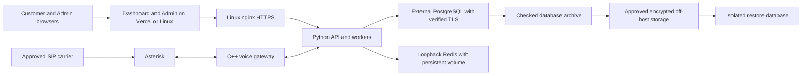

# Talklee Linux installation and recovery

This is the entry point for rebuilding Talklee on a new Ubuntu 24.04 amd64
server with PostgreSQL hosted separately. The local installer and recovery
tools implement the October 30 production deliverables. Their checks do not
establish that production has been migrated or that a clean Linux server has
passed acceptance; those outcomes require the recorded rehearsals below.

The installer uses the existing Python API/workers, C++ voice gateway and
Asterisk architecture. It supports `frontend_mode=external` for the documented
Vercel frontends and `frontend_mode=linux` to install both frontends on the new
host. Select the intended mode in the deployment record before applying it.

## Start locally

These commands show the installation plan and check the local safety tests.
They do not contact production, create a server or load real credentials.

```powershell
python scripts/installation/install.py plan
python -m unittest discover -s scripts/installation -p test_install.py -v
python -m unittest discover -s scripts/database/tests -p "test_*.py" -v
```

On Linux, `bash install_talklee.sh` prints the same plan. The installer package
contains [configuration examples and full commands](scripts/installation/README.md).
The [database recovery guide](docs/production-readiness/database-recovery.md)
describes audit, backup, isolated restore and the production cutover sequence.

## Deployment layout



The separate database host and off-host backup store are required operating
inputs. A hostname or different IP alone does not prove physical independence.
Record where the database, recordings, connector encryption keys and backups
actually live, and prove recovery after loss of the application server.

## Prerequisites and exact versions

1. Supply a clean Ubuntu 24.04 amd64 VM with console access, DNS control and
   a reviewed full repository commit. Installation refuses an existing Talky,
   nginx, Asterisk or Docker installation. It is not an in-place upgrade tool.
2. Prepare the external database with the reviewed schema and restricted runtime
   role. Restore and rehearse migrations on an isolated copy first. Follow the
   existing [bootstrap history](backend/database/MIGRATIONS.md); never stamp an
   old snapshot at the current head. Read actual heads from the selected commit.
3. Prepare exact Ubuntu package versions, a complete hash-locked Linux/Python
   3.12 requirements file, and a Redis image digest. Linux frontend mode also
   needs the approved Node 22 archive version and checksum. The installer
   consumes these reviewed pins and records installed versions. Preparing a
   lock is not the same as qualifying its dependency closure.
4. Supply reviewed Asterisk configuration for the actual carrier/PBX, public
   TLS certificates, database CA, runtime environment and network allow-lists.
   Existing lab telephony configurations are not production inputs.
5. Preserve the existing encryption keys when restoring existing data. A new
   secret-store or connector key cannot decrypt old database ciphertext.

See the [input contract](scripts/installation/README.md#qualified-inputs) for
formats, validation and dependency-lock preparation. Pin extension/client
versions with the database inventory; some historical schema snapshots require
a newer PostgreSQL client than the server itself.

## Configuration and secrets

| File or group | Purpose |
| --- | --- |
| [install.example.json](scripts/installation/install.example.json) | Domains, ports, allow-lists, immutable source, frontend mode and paths to protected inputs |
| [backend/.env.example](backend/.env.example) | Existing application configuration and optional feature settings |
| [backend.env.example](scripts/installation/backend.env.example) | Required fresh-host runtime settings, with placeholders that must be replaced |
| [dashboard.env.example](scripts/installation/dashboard.env.example) | Public dashboard build configuration for Linux frontend mode |
| [admin.env.example](scripts/installation/admin.env.example) | Public Admin build configuration with development authentication disabled |
| `/etc/talky/migration.env` | Operator-only `MIGRATION_DATABASE_URL`; never loaded by API or workers |
| [pg_service.conf.example](scripts/database/pg_service.conf.example) and `PGPASSFILE` | Separate runtime audit, backup and isolated-restore identities without credentials in commands |

Required runtime settings and their purpose are listed in the fresh-host
example. Use the existing provider configuration to decide which additional
provider keys are needed. Stripe and Google OAuth credentials must match the
approved account and callback/webhook configuration supplied by their owners.
Browser variables are public; never place service secrets in `NEXT_PUBLIC_*`
or `VITE_*` variables.

Store populated files outside the checkout with restricted permissions. The
installer copies only runtime credentials to `backend/.env`, readable by the
`talky` service account. It does not regenerate production keys. Document the
secret-manager location, authorized operator and tested rotation procedure;
handover documents must contain references, not secret values.

## DNS and network inventory

| Endpoint | Exposure and purpose |
| --- | --- |
| API hostname | HTTPS 443 to nginx; HTTP 80 redirects to HTTPS |
| Dashboard and Admin hostnames | Existing external hosting or nginx on the new host, according to selected mode |
| SSH | Configured port restricted to management CIDRs |
| SIP and RTP | Reviewed SIP port and media range restricted to the approved carrier/media CIDRs |
| API 8000, gateway 18080, Redis 6379, Asterisk ARI | Host loopback only |
| External PostgreSQL | Private network or allow-listed application/backup hosts; verified TLS |

Configure Asterisk transports, ARI identity/port, NAT addresses and RTP ranges
to match the supplied runtime environment and firewall. Reconcile generated
tenant trunks from authoritative records before allowing calls. Record DNS
provider, current records, certificate issuer and renewal owner in handover.

## Install and validate on the new host

After all protected inputs are prepared, run from the reviewed clean checkout:

```bash
bash install_talklee.sh validate --config /secure/talky/install.json
sudo bash install_talklee.sh apply \
  --config /secure/talky/install.json \
  --source /path/to/clean/reviewed-checkout \
  --confirm-new-host
```

The installer creates services, configures restricted ingress, and verifies
gateway protocol, API health and HTTPS. Linux mode also builds and checks the
frontends. The receipt and installed versions go to `/var/lib/talky-install`.
Application schema preparation is deliberately separate from starting workers:
do not point this full installer at a recovery-test database and accidentally
allow restored pending jobs to run.

If installation fails, preserve its state and diagnostic logs, repair the
input, and repeat on a new empty VM. Automatic cleanup does not destroy or
reset a partially installed host. Rehearse a reboot and confirm service health
before a controlled call to an approved destination.

## Update rollback and disaster recovery

The established [release procedure](docs/DEPLOYMENT.md) still requires a pinned
compatible code/schema/gateway version, verified backup and measured carrier,
PBX, Redis and database drain. Production migration or DNS cutover is a separate
operator action after rehearsals and a reviewed maintenance plan.

The new host runs application services as `talky` and protects source/binaries
with root ownership. The existing `deploy_to_server.sh` assumes the older
`admins` deployment profile. Its unchanged update command must not be used on
the new profile. The installer [update instructions](scripts/installation/README.md#updates-and-recovery)
document the ownership boundary and bounded gateway publication. Qualify the
complete operator update/rollback procedure on the new VM before handover.

Keep the old database intact during cutover. Returning to it after writes begin
on the new database is a data-reconciliation decision, not simply an endpoint
change. Recovery must also reconcile deletion obligations, pending jobs,
recording storage and keys; avoid replaying calls, payments or connector actions.

## Acceptance and handover

The operating reviewer records each result, environment, source SHA, timestamp
and evidence path. Local test success does not close these items.

- External database location and least-privilege application access demonstrated.
- Authorized backup copied off-host and restored into an isolated database;
  critical records, tenant isolation, storage and keys verified; recovery targets measured.
- Clean Ubuntu rebuild by an engineer following only these documents, including
  correct frontend mode, health, reboot, generated trunks and controlled call.
- Backup retention/PITR capability, failure/age/capacity alerts and certificate
  renewal configured with named owners; alert delivery demonstrated.
- Compatible update and rollback/recovery rehearsed; Stripe and Admin owners'
  deployed acceptance evidence attached to the four-deliverable review.
- Architecture, server/service inventory, environment and DNS inventory,
  Stripe/Google OAuth/PBX setup references and secret rotation references complete.
- Installation, update and backup/restore walkthrough videos captured from the
  successful rehearsals. A script or written walkthrough is not a delivered video.

Use the [handover record](docs/production-readiness/infrastructure-handover.example.json)
to keep unresolved inputs explicit. The wider production-readiness feature
freeze remains in effect until its own recorded completion conditions are met.
