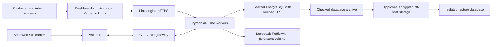

# Talklee Linux installation and recovery

This is the entry point for rebuilding Talklee on a new Ubuntu 24.04 amd64
server with PostgreSQL hosted separately. The local installer and recovery
tools implement the October 30 production deliverables. Their checks do not
establish that production has been migrated or that a clean Linux server has
passed acceptance; those outcomes require the recorded rehearsals below.

The installer uses the existing Python API/workers, C++ voice gateway and
Asterisk architecture. Use **`frontend_mode=linux` for the complete Ubuntu
installation**: customer dashboard, Admin, backend, gateway and telephony on
the new application host. `frontend_mode=external` intentionally leaves the
frontends on their separately managed hosting; it does not install them.

## Clone the full release on Ubuntu first

Use the reviewed full commit supplied with the release. The script-only ZIP is
an inspection kit; applying it requires the complete Git repository. Git access
must be configured without embedding access tokens in the repository URL.

On a fresh Ubuntu 24.04 amd64 server, install the small checkout prerequisites
if the image does not already have them, then clone outside `/opt/talky`:

```bash
set -eu
sudo apt-get update
sudo apt-get install --yes git python3 ca-certificates
git clone https://github.com/talkyai-source/Talky.ai-complete-.git talklee-install-source
cd talklee-install-source
TALKLEE_RELEASE_SHA='REPLACE_WITH_REVIEWED_40_CHARACTER_RELEASE_COMMIT'
git checkout --detach "$TALKLEE_RELEASE_SHA"
test "$(git rev-parse HEAD)" = "$TALKLEE_RELEASE_SHA"
test -z "$(git status --porcelain)"
bash install_talklee.sh plan
```

Keep this checkout clean. Put populated configuration, credentials and prepared
dependency files outside it. The installer clones this exact source into
`/opt/talky`; it refuses an existing installation. Downloaded archives without
Git metadata and a repository origin are not a replacement for this checkout.

Next generate the protected input directory from the release:

```bash
sudo python3 scripts/installation/prepare.py --source "$PWD" --output /secure/talky
```

The helper checks the bundled Python lock/provenance, records the source SHA,
collects exact Ubuntu package candidates and immutable Node/Redis download
identities, and writes Linux-mode configuration templates. It refuses an
existing output directory and does not install packages or start services.
Follow [Prepare Ubuntu inputs](scripts/installation/PREPARE-UBUNTU.md) to fill
the environment-specific database, accounts, DNS, certificate and telephony
values. A successful `plan` or preparation run does not bring a service online.

The launcher runs Python. Python installs the pinned Ubuntu and Python
packages, builds/tests the C++ gateway, and configures nginx, Asterisk, Redis,
the firewall and systemd services. In Linux frontend mode it also runs
`npm ci --include=dev` and `npm run build` in both frontend projects. npm is
the frontend dependency/build step, not the installer for the whole platform.

## Start locally

These commands show the installation plan and check the local safety tests.
They do not contact production, create a server or load real credentials.

```powershell
python scripts/installation/install.py plan
python -m unittest discover -s scripts/installation -p test_install.py -v
python -m unittest discover -s scripts/database/tests -p "test_*.py" -v
```

On Linux, `bash install_talklee.sh` prints the same plan. The installer package
contains [configuration examples and full commands](scripts/installation/README.md).
The [database recovery guide](docs/production-readiness/database-recovery.md)
describes audit, backup, isolated restore and the production cutover sequence.

## Deployment layout



The separate database host and off-host backup store are required operating
inputs. A hostname or different IP alone does not prove physical independence.
Record where the database, recordings, connector encryption keys and backups
actually live, and prove recovery after loss of the application server.

## Prerequisites and exact versions

1. Supply a clean Ubuntu 24.04 amd64 VM with console access, DNS control and
   a reviewed full repository commit. Installation refuses an existing Talky,
   nginx, Asterisk or Docker installation. It is not an in-place upgrade tool.
2. Prepare the external database with the reviewed schema and restricted runtime
   role. Restore and rehearse migrations on an isolated copy first. Follow the
   [fresh-database preparation](scripts/installation/PREPARE-UBUNTU.md#prepare-the-external-database)
   and existing [bootstrap history](backend/database/MIGRATIONS.md); never
   stamp an old snapshot at the current head. Read actual heads from the
   selected commit; historical prose can name an older head. Separate
   migration and runtime roles also need reviewed grants and runtime access
   checks, not just matching revision numbers. For the supported dedicated
   PostgreSQL 16 canonical-0082 profile, use the reviewed
   [runtime grants procedure](scripts/database/RUNTIME_GRANTS.md) and retain
   successful real runtime-login verification before starting services.
3. Use the preparation helper to copy the matching release's Linux/Python 3.12
   hash lock and collect exact Ubuntu package versions, a Redis image digest
   and the Node 22 archive version/checksum. Review its provenance and qualify
   the artifacts on Ubuntu. The installer consumes these pins and records
   installed versions; collecting them is not dependency acceptance.
4. Supply reviewed Asterisk configuration for the actual carrier/PBX, public
   TLS certificates, database CA, runtime environment and network allow-lists.
   Existing lab telephony configurations are not production inputs.
5. Preserve the existing encryption keys when restoring existing data. A new
   secret-store, connector or TOTP encryption key cannot decrypt old database
   ciphertext. The installer requires a valid `TOTP_ENCRYPTION_KEY` for MFA.
6. For a genuinely new database, use the protected
   [first-administrator procedure](docs/operations/FIRST-ADMIN.md). It requires
   mailbox ownership and a working authenticator, creates no default password,
   and refuses to promote or reset an existing account. Restored administrators
   retain their normal recovery workflow.

See the [input contract](scripts/installation/README.md#qualified-inputs) for
formats, validation and dependency-lock preparation. Pin extension/client
versions with the database inventory; some historical schema snapshots require
a newer PostgreSQL client than the server itself.

## Configuration and secrets

| File or group | Purpose |
| --- | --- |
| [install.example.json](scripts/installation/install.example.json) | Domains, ports, allow-lists, immutable source, frontend mode and paths to protected inputs |
| [backend/.env.example](backend/.env.example) | Existing application configuration and optional feature settings |
| [backend.env.example](scripts/installation/backend.env.example) | Required fresh-host runtime settings, with placeholders that must be replaced |
| [dashboard.env.example](scripts/installation/dashboard.env.example) | Public dashboard build configuration for Linux frontend mode |
| [admin.env.example](scripts/installation/admin.env.example) | Public Admin build configuration with development authentication disabled |
| `/etc/talky/migration.env` | Operator-only `MIGRATION_DATABASE_URL`; never loaded by API or workers |
| [pg_service.conf.example](scripts/database/pg_service.conf.example) and `PGPASSFILE` | Separate runtime audit, backup and isolated-restore identities without credentials in commands |

Required runtime settings and their purpose are listed in the fresh-host
example. Use the existing provider configuration to decide which additional
provider keys are needed. Stripe and Google OAuth credentials must match the
approved account and callback/webhook configuration supplied by their owners.
Browser variables are public; never place service secrets in `NEXT_PUBLIC_*`
or `VITE_*` variables.

Store populated files outside the checkout with restricted permissions. The
installer copies only runtime credentials to `backend/.env`, readable by the
`talky` service account. It does not regenerate production keys. Document the
secret-manager location, authorized operator and tested rotation procedure;
handover documents must contain references, not secret values.

## DNS and network inventory

| Endpoint | Exposure and purpose |
| --- | --- |
| API hostname | HTTPS 443 to nginx; HTTP 80 redirects to HTTPS |
| Dashboard and Admin hostnames | Existing external hosting or nginx on the new host, according to selected mode |
| SSH | Configured port restricted to management CIDRs |
| SIP and RTP | Reviewed SIP port and media range restricted to the approved carrier/media CIDRs |
| API 8000, gateway 18080, Redis 6379, Asterisk ARI | Host loopback only |
| External PostgreSQL | Private network or allow-listed application/backup hosts; verified TLS |

Configure Asterisk transports, ARI identity/port, NAT addresses and RTP ranges
to match the supplied runtime environment and firewall. Reconcile generated
tenant trunks from authoritative records before allowing calls. Record DNS
provider, current records, certificate issuer and renewal owner in handover.

## Install and validate on the new host

After all protected inputs are prepared, use a root login shell and the
required `0022` umask so the installed source directories remain readable by
the `talky` service account. Replace the checkout and input paths below with
their actual absolute paths:

```bash
sudo -i
umask 0022
cd /absolute/path/to/talklee-install-source
bash install_talklee.sh validate --config /secure/talky/install.json
bash install_talklee.sh apply \
  --config /secure/talky/install.json \
  --source "$PWD" \
  --confirm-new-host
```

Secret inputs and installed secret files retain their explicitly protected
permissions; the source-directory umask does not make them public. The
installer scopes Git trust to the selected source for its own commands; do
not configure a global `safe.directory=*` exception.

The installer creates services, configures restricted ingress, and verifies
gateway protocol, API health and HTTPS. Linux mode also builds and checks the
frontends. The receipt and installed versions go to `/var/lib/talky-install`.
Application schema preparation is deliberately separate from starting workers:
do not point this full installer at a recovery-test database and accidentally
allow restored pending jobs to run.

`validate` checks input structure without connecting to services. `apply`
installs and starts the application, including workers, and verifies runtime
database identity/TLS/revision plus local service health and HTTPS. Neither
command provisions an external database, purchases a phone number, registers
provider accounts, issues a TLS certificate or establishes call permission.

If installation fails, preserve its state and diagnostic logs, repair the
input, and repeat on a new empty VM. Automatic cleanup does not destroy or
reset a partially installed host. Rehearse a reboot and confirm service health
before a controlled call to an approved destination.

## Update rollback and disaster recovery

The established [release procedure](docs/DEPLOYMENT.md) still requires a pinned
compatible code/schema/gateway version, verified backup and measured carrier,
PBX, Redis and database drain. Production migration or DNS cutover is a separate
operator action after rehearsals and a reviewed maintenance plan.

The new host runs application services as `talky` and protects source/binaries
with root ownership. The existing `deploy_to_server.sh` assumes the older
`admins` deployment profile. Its unchanged update command must not be used on
the new profile. The new [fresh-host release procedure](scripts/installation/FRESH-RELEASE.md)
stages both frontends, the backend and gateway; binds their artifacts to the
reviewed source; and preserves the private configuration and data directories.
It reuses the existing freeze/drain contract, verifies a fresh database backup,
and permits automatic code rollback only before a migration begins. Its full
VM update/recovery acceptance is being qualified separately from the successful
blank-host install and reboot. Follow that guide's recorded acceptance status
before using it for a customer release.

Keep the old database intact during cutover. Returning to it after writes begin
on the new database is a data-reconciliation decision, not simply an endpoint
change. Recovery must also reconcile deletion obligations, pending jobs,
recording storage and keys; avoid replaying calls, payments or connector actions.

## Acceptance and handover

The operating reviewer records each result, environment, source SHA, timestamp
and evidence path. Local test success does not close these items.

- External database location and least-privilege application access demonstrated.
- Authorized backup copied off-host and restored into an isolated database;
  critical records, tenant isolation, storage and keys verified; recovery targets measured.
- Clean Ubuntu rebuild by an engineer following only these documents, including
  correct frontend mode, health, reboot, generated trunks and controlled call.
- Backup retention/PITR capability, failure/age/capacity alerts and certificate
  renewal configured with named owners; alert delivery demonstrated.
- Compatible update and rollback/recovery rehearsed; Stripe and Admin owners'
  deployed acceptance evidence attached to the four-deliverable review.
- Architecture, server/service inventory, environment and DNS inventory,
  Stripe/Google OAuth/PBX setup references and secret rotation references complete.
- Installation, update and backup/restore walkthrough videos captured from the
  successful rehearsals. A script or written walkthrough is not a delivered video.

Use the [handover record](docs/production-readiness/infrastructure-handover.example.json)
to keep unresolved inputs explicit. The wider production-readiness feature
freeze remains in effect until its own recorded completion conditions are met.
